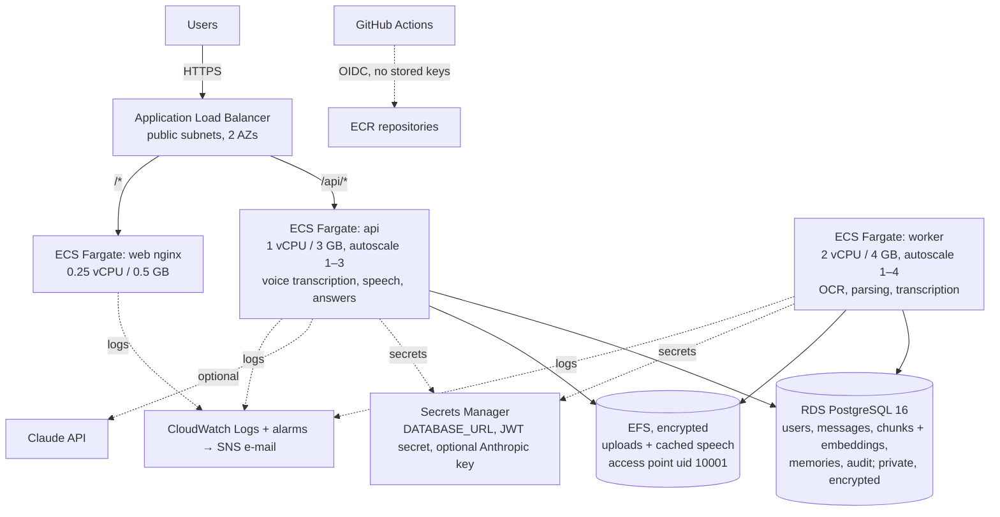

# AWS deployment

> **Status: designed, not deployed.** Nothing in this repository creates AWS resources automatically. The Terraform has **not** been applied, and was not validated locally (CI runs `fmt` and `validate`). Deploying requires a reviewed `terraform plan` and the budget alert below.

## Architecture



| Concern | Design |
|---|---|
| Network | VPC with 2 public subnets (ALB, NAT) and 2 private subnets (tasks, RDS, EFS mount targets) |
| Security groups | ALB: 80/443 from the internet. Tasks: only from the ALB. RDS: 5432 only from tasks. EFS: 2049 only from tasks |
| Storage | EFS with encryption at rest and in transit, an access point that pins uid/gid 10001 and confines tasks to `/files`, a lifecycle policy to infrequent access after 30 days, and AWS Backup |
| Models | Baked into the API image at build time; tasks start offline (`HF_HUB_OFFLINE=1`) with no download step and no egress to Hugging Face |
| IAM | Execution role: pull images, write logs, read the app secrets. Task role: no AWS permissions. Deploy role: GitHub OIDC limited to this repository |
| Secrets | Generated by Terraform and injected by ECS. They also exist in Terraform state, so **the state bucket must be encrypted and access-restricted** |
| Availability | Deployment circuit breaker with automatic rollback; CPU autoscaling for the API and the worker; a 120 s health-check grace period while models load. Single NAT and single-AZ RDS by default (cost); set `single_nat_gateway=false` and `db_multi_az=true` for production |
| Monitoring | Alarms: API 5xx, unhealthy targets, p95 latency, RDS CPU and storage, job failures. Monthly budget alert |

## Cost estimate (us-east-1, on-demand, defaults)

These are approximate list prices; confirm with the [AWS Pricing Calculator](https://calculator.aws/) before deploying.

| Resource | Size | ≈ USD / month |
|---|---|---|
| Fargate: worker | 2 vCPU / 4 GB × 730 h | ~72 |
| Fargate: api | 1 vCPU / 3 GB × 730 h | ~39 |
| Fargate: web | 0.25 vCPU / 0.5 GB × 730 h | ~9 |
| NAT gateway | 1 × 730 h + light data | 33–40 |
| Application Load Balancer | 1, low traffic | 18–22 |
| RDS PostgreSQL | db.t4g.micro, 20 GB gp3, single-AZ, backups | 15–18 |
| EFS | a few GB, elastic throughput, backups | 1–5 |
| CloudWatch logs, metrics, alarms, Container Insights | low volume | 8–12 |
| Secrets Manager, ECR | 2–3 secrets; images about 1.5 GB each, 20 kept | 3–5 |
| Claude API (only if enabled) | per reply: roughly 1–6k input and 100–400 output tokens at `claude-opus-5-5` list price ($4 / $20 per million), so about $0.01–0.03; shown on every reply | usage-based |
| **Total (excluding Claude usage)** | | **≈ $200–225 / month** |

Ways to cut cost:
- **Smaller worker:** 1 vCPU / 3 GB (about $37) when uploads are rare; processing takes about twice as long.
- **Scale the worker to zero when idle:** `min_capacity = 0` with a queue-depth alarm to scale back up.
- **Demo environment:** `aws ecs update-service --desired-count 0` for all services, plus
  `aws rds stop-db-instance`. The NAT gateway and ALB keep billing while they exist.

## Deploy (first time)

Prerequisites: AWS CLI v2 logged in as an administrator (SSO recommended), Terraform ≥ 1.9, Docker.

1. Create the state bucket once, with versioning, encryption and public access blocked. Then:
   ```bash
   cd infra/terraform
   ```
   ```bash
   cp backend.hcl.example backend.hcl && cp terraform.tfvars.example terraform.tfvars
   ```
   Edit both files, then:
   ```bash
   terraform init -backend-config=backend.hcl
   ```
2. Create the registries first, so images can be pushed before the services start:
   ```bash
   terraform plan -target=module.app.aws_ecr_repository.api -target=module.app.aws_ecr_repository.web -out=ecr.plan
   ```
   ```bash
   terraform apply ecr.plan
   ```
3. Build and push the images. Use a git SHA tag; the tags are immutable. The API image build downloads
   the models (about 400 MB).
   ```bash
   TAG=$(git rev-parse --short HEAD); API=$(terraform output -raw ecr_api_repository); WEB=$(terraform output -raw ecr_web_repository)
   ```
   ```bash
   aws ecr get-login-password | docker login --username AWS --password-stdin ${API%/*}
   ```
   ```bash
   docker build -t $API:$TAG ../../backend && docker push $API:$TAG && docker build -t $WEB:$TAG ../../frontend && docker push $WEB:$TAG
   ```
4. **Review the full plan.** It lists every resource that will be created.
   ```bash
   terraform plan -var image_tag=$TAG -out=full.plan
   ```
5. After reviewing the plan:
   ```bash
   terraform apply full.plan
   ```
6. Run the database migrations as a one-off task:
   ```bash
   eval "$(terraform output -raw migrate_command)"
   ```
7. Create the first admin with a one-off task, overriding the command to `python -m app.cli create-user --email ... --role admin` and passing `MMA_USER_PASSWORD` as an environment override.
8. *(Optional, Claude mode)* Deploy with `-var enable_claude=true`, then put the key **before** the services start, so it never appears in Terraform state:
   ```bash
   aws secretsmanager put-secret-value --secret-id mma/anthropic-api-key --secret-string 'sk-ant-...'
   ```
9. Open `terraform output app_url`.

## Update / rollback
- **Deploy a new version:** build and push a new `$TAG`, then `terraform apply -var image_tag=$TAG`. ECS performs a rolling deployment, and the circuit breaker rolls back automatically if new tasks fail their health checks.
- **Manual rollback:** `terraform apply -var image_tag=<previous tag>`. The last 20 images are kept per repository.
- **Database migrations** must stay backwards-compatible with the previous app version (add columns, never rename them in one step), so that rolling back the app never requires rolling back the schema.
- **Changing a model** (for example `MMA_STT_MODEL=small.en`) needs a new image, because models are baked in. Re-run the evaluation and compare before deploying.
- **Turning Claude off** needs no new image: set `MMA_LLM_PROVIDER=local` in the task definition.

## Teardown
1. Take a manual RDS snapshot, and copy the EFS files if you want to keep them.
2. RDS has `deletion_protection = true`. Set it to `false` in `modules/data/main.tf`, then `terraform apply`.
3. Delete all images from the two ECR repositories (`aws ecr batch-delete-image`).
4. Destroy everything:
   ```bash
   terraform destroy
   ```
   RDS writes a final snapshot (`mma-db-final`). Delete it afterwards if you don't need it; it costs about $0.095 per GB-month. EFS recovery points in AWS Backup must be deleted separately.
5. Secrets Manager secrets enter a 7-day recovery window and are then deleted.
6. Check the Billing console the next day to confirm nothing remains: NAT gateways, EIPs, load balancers, snapshots, backup vaults.
