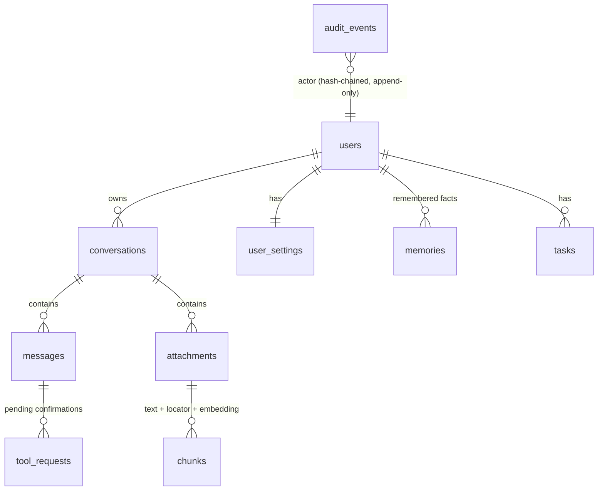
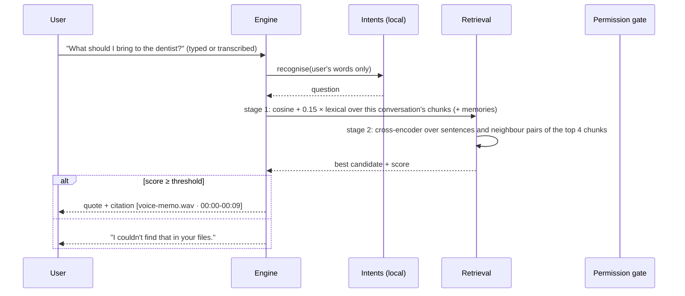

# Design — Multimodal AI Assistant

## Goals and non-goals

**Goals**
- Accept every common input: typed text, speech, photos and screenshots, scanned and digital PDFs, Word
  documents, plain text and audio recordings.
- Ground every answer about a file in a quoted passage with a precise locator, and **decline** when the
  files don't contain the answer.
- Work fully offline on CPU. Claude is an optional upgrade, not a dependency.
- Let the assistant act (tasks, memory) without letting a file or a model act on the user's behalf
  without consent.
- Keep the user in control of their data: visible memory, deletion, export, and an audit trail of actions.

**Non-goals (for now):** real-time streaming conversation (barge-in, partial transcripts), video, multiple
languages, collaborative conversations, calendar and e-mail integrations.

## Components

| Component | Responsibility |
|---|---|
| `app/media/files.py` | Type detection from magic bytes (a script renamed `photo.jpg` is rejected); a file store with random keys and a path-traversal guard |
| `app/media/process.py` | Turns a file into text plus **chunks with locators**: OCR for images, pdfplumber per page with an OCR fallback for scanned pages, python-docx paragraphs and tables, Whisper transcription with timestamps |
| `app/media/models.py` | Lazy, process-wide loaders for Whisper, Piper, RapidOCR, the embedder and the cross-encoder |
| `app/jobs` | PostgreSQL job queue (`FOR UPDATE SKIP LOCKED`); the worker runs `process_attachment` |
| `app/assistant/retrieval.py` | Two-stage retrieval: embeddings + lexical overlap, then cross-encoder reranking of sentences |
| `app/assistant/intents.py` | Offline intent rules over the user's own words (never over file text) |
| `app/assistant/local.py` | The local provider: tools, extractive answers, summaries, transcripts, image descriptions |
| `app/assistant/claude.py` | The Claude provider: numbered sources, image blocks, a tool loop, cost metering, fallback to local |
| `app/assistant/base.py` | The single permission gate every tool call goes through |
| `app/assistant/engine.py` | One turn end to end; confirmation requests; approve/decline; audit records |
| `app/evaluation` | The evaluation suite and the scripted Claude stand-ins (one obeys injections) |

## Data model

- `chunks.embedding` is a `real[]`. Search runs inside a single conversation, which holds tens to
  hundreds of chunks, so a NumPy dot product is faster and simpler than an ANN index. pgvector would be
  needed for search across all of a user's files (see limitations).
- `messages` store citations, tool events, the provider, token usage and latency, so every reply can be
  explained later.
- `user_settings.tool_permissions` stores only the user's overrides; defaults live in code, so new tools
  get safe defaults.
- `audit_events` is hash-chained and protected by a trigger against UPDATE and DELETE. It records
  **actions** (tool runs, confirmations, deletions, setting changes), never message contents.

## Processing pipeline

1. **Upload** (`POST /conversations/{id}/attachments`). The API enforces a size limit and detects the
   type from the file's content. The file is stored under a random key; the user's filename is never
   used as a path. A `process_attachment` job is enqueued, and the API returns `202`.
2. **Worker**:
   - **Images:** EXIF orientation is applied, and the image is downscaled to at most 2,000 px. RapidOCR
     finds text boxes, which are sorted into reading order and grouped into visual lines. Image
     properties (size, dominant colours, brightness) are kept as metadata.
   - **PDFs:** text is extracted per page. A page with fewer than 20 characters is treated as scanned:
     it is rendered at 200 dpi and OCR'd.
   - **DOCX:** paragraphs, plus table rows written as `Header: value; Header: value`. A row like
     `Design review | Priya Raman` means nothing without its header, and this format fixed a measured
     retrieval failure.
   - **Audio:** faster-whisper (`base.en`, int8, voice-activity filter), with segments grouped into
     roughly 25-second windows.
   - **Chunking:** paragraphs are packed up to 600 characters. Each chunk keeps its locator (`page 3`,
     `lines 7-12`, `01:05-01:31`) and is embedded with `bge-small-en-v1.5`.
3. Failures that can be predicted (a corrupt image, an undecodable recording, too many pages) are stored
   on the attachment with a readable message; processing is deterministic, so they are not retried.

## Answering a question

**Why two stages.** The first version thresholded retrieval cosine similarity. The evaluation showed it
couldn't tell answerable from unanswerable questions. "Can I freeze the lemon bars?" sits as close to the
recipe as "How long should the bars cool?" does, because both are about the recipe. A cross-encoder reads
question and passage *together* and scores whether this passage answers this question. The sweep in the
evaluation report shows the difference: the cross-encoder threshold that keeps 92% of answerable
questions rejects 86% of unanswerable ones; the best cosine threshold rejects 57%.

**Details that came from measured failures:**
- **Neighbour pairs.** Candidates include pairs of adjacent sentences, because a heading and its value
  are often on separate lines (`TEAM OFFSITE` / `Friday 9:30 in Room 4B`).
- **Passage penalty.** The final score subtracts 10 × how far a candidate's chunk trails the best chunk
  in stage 1. Without it, "What is the dentist's phone number?" was answered with a warranty card's
  support number. The cross-encoder liked that sentence, but stage 1 knew the question was about the
  voice memo.
- **No title prefixes.** Prefixing each candidate with its file's first line looked like it would help
  ("CEDAR STREET CAFE: TOTAL 23.85"). The measurement showed it lowered scores for receipts sharply, so
  it was removed.
- **Lexical overlap** in stage 1 keeps exact identifiers (serial numbers, invoice numbers) that embeddings
  blur.

**What the local provider will and won't do.** It is extractive: it quotes and never generates facts.
Summaries pick the sentences closest to the document's centroid, in their original order. "What's in this
image?" reports size, colours and the text found, and says plainly that recognising objects needs the
Claude provider.

## Providers

| | Local (default) | Claude (`ANTHROPIC_API_KEY`) |
|---|---|---|
| Intent → tools | Rules over the user's words | Claude tool use, loop of up to 6 rounds |
| File content | Retrieved and quoted | All chunks as numbered `<file>` sources if they fit in 40k characters, otherwise the best 12; images as image blocks (last 3) |
| Citations | The quoted passage | `[n]` markers parsed into citations, keeping only the cited sources |
| Failure | — | Any API error → the local provider answers, labelled "Claude unavailable" |
| Cost | Free | Tokens metered per reply at the Opus 5.5 list price ($4 / $20 per million) |

The system prompt tells Claude that file contents are data, not instructions. **That is not the
defence.** The defence is the gate below, which doesn't depend on the model behaving.

## The permission gate

Every tool call from either provider goes through `base.call_tool`:

1. Unknown tool → failed.
2. The user's permission is **deny** → not run; the model is told the tool is off.
3. The permission is **ask** → a `ToolRequest` is created and shown as a card; nothing runs until the user
   confirms. A request can be decided only once (a row lock plus a status check) and only by its owner.
4. **Taint rule:** if the model that chose the call had file contents in its context, every tool that
   **changes data** needs confirmation, even when it is normally *allow*.
5. Otherwise the tool runs inside a savepoint, and data-changing runs are audited.

The local provider is immune to injection by construction: intents come only from the user's own words.
The evaluation also runs `AttackerClaude`, a scripted model that requests `forget_memory`, `create_task`
and `save_memory` whenever it sees the injected note. The check is that no user data changes. A control
case checks the gate isn't simply blocking everything: with no files in context, the same model saving a
memory the *user* asked for succeeds.

## Voice

- **In:** the browser records with `MediaRecorder` (WebM/Opus, up to 120 s) and posts to
  `/conversations/{id}/voice`. The API transcribes synchronously (a short clip takes about 1–3 s on CPU),
  stores the message with `input_mode = voice` and the transcription metadata, and answers it like text.
- **Out:** `GET /messages/{id}/speech` strips citation markers and markdown, synthesises a WAV with Piper,
  stores it, and serves the cached file afterwards. "Read replies aloud" in Settings plays every reply
  automatically.

## Security and privacy

- Argon2id passwords, 15-minute JWT access tokens held in memory only, and rotating httpOnly refresh
  cookies with reuse detection. Account lockout and rate limits apply to login and chat.
- Every conversation, file, memory, task and tool request is scoped to its owner. Other users get `404`,
  not `403`, so the existence of an object isn't revealed. Viewers are read-only.
- Uploads: content-based type detection, a size limit, a PDF page limit and an audio duration limit.
  Files are served with `Content-Disposition` and `nosniff`. The CSP allows `blob:` only for previews and
  audio playback.
- Deleting a conversation deletes its messages, attachments, extracted text, embeddings, cached speech
  and stored files. `GET /me/export` returns everything stored about the user.
- The UI states where data goes: the header shows "Local models · offline" or the Claude model, and
  Settings explains when file contents are sent to the Claude API.

## Decisions and trade-offs

| Decision | Alternatives | Why |
|---|---|---|
| RapidOCR (PP-OCR, ONNX) | Tesseract, cloud OCR | pip-installable with no system packages, accurate on photos and receipts, CPU-fast |
| faster-whisper `base.en` int8 | `tiny.en`, `small.en`, cloud STT | 4% WER on the benchmark, faster than real time on CPU; the model is configurable |
| Piper (LJSpeech voice) | Cloud TTS, eSpeak | Natural voice, fast on CPU, public-domain training data |
| Cross-encoder answerability | Cosine threshold, an LLM judge | Measured to separate answerable from unanswerable far better than cosine, with no API |
| Extractive local answers | A small local LLM | No hallucinated facts and no GPU; Claude covers generation when enabled |
| Embeddings as `real[]` | pgvector | Search is per conversation, so the data is small; one less extension to operate |
| Synchronous voice transcription | A job + polling | Short clips; the user waits for the reply anyway, and it removes a round trip |
| Background processing of uploads | Synchronous | Large PDFs and long recordings take seconds to minutes |
| File taint rule | Trusting the model | Prompt injection is unsolved at the model level; the gate makes it harmless |
